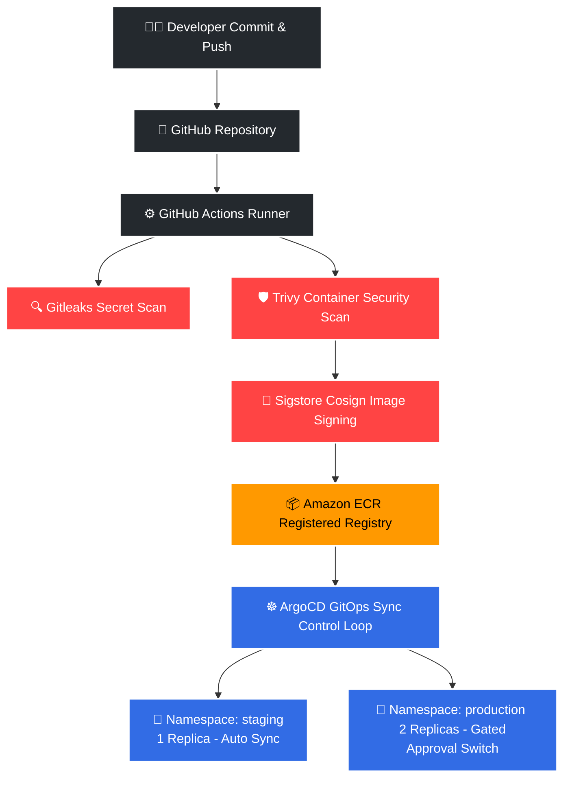
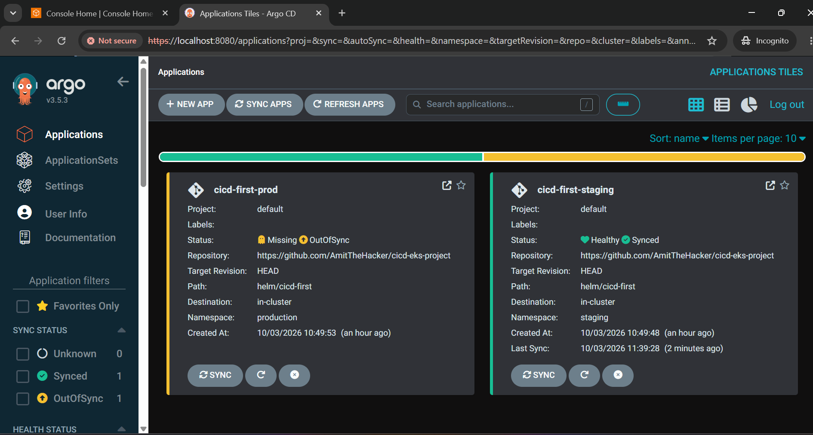
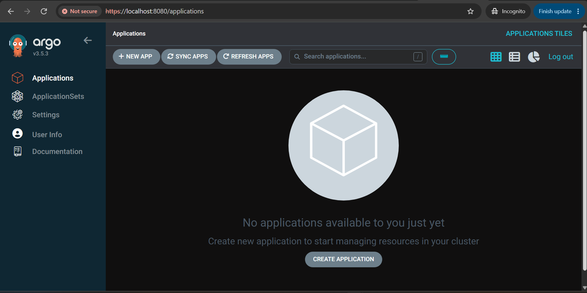
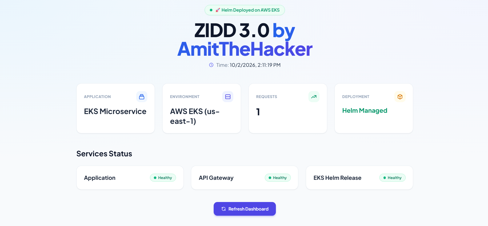
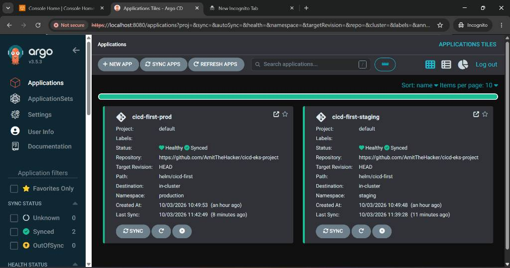
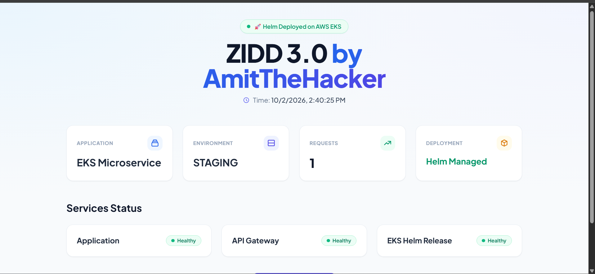
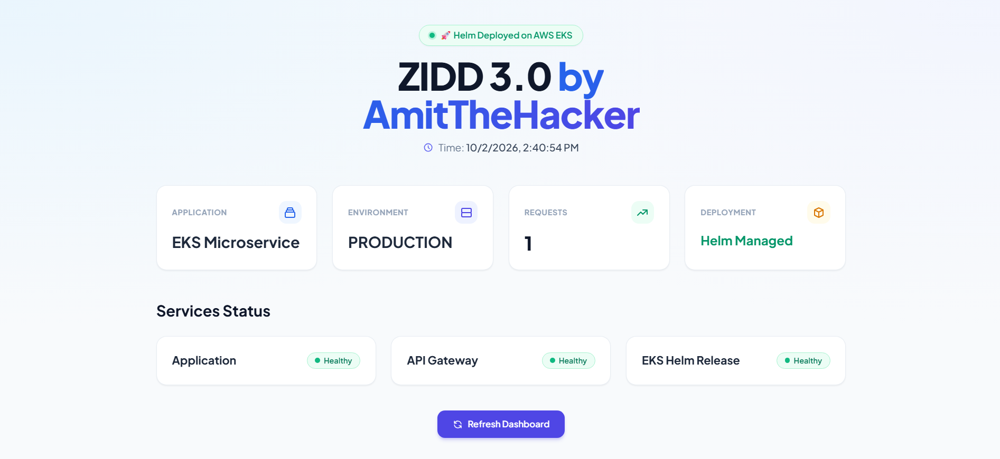

# 🚀 Enterprise DevSecOps Fleet: AWS EKS, ArgoCD GitOps, Helm & Cosign Enforced

This repository showcases a cutting-edge, enterprise-grade **Multi-Environment DevSecOps Automation Engine** driven by a strict GitOps pull-based model. By eliminating structural anti-patterns, this workspace secures modern cloud architectures via cryptographic binary enforcement, granular secret filtering, infrastructure-as-code, and isolated environment strategies.

---

## 🏗️ Architectural Topology & Component Governance




1. **Infrastructure as Code (IaC):** Virtual Private Clouds (VPC), subnet mappings, elastic container registries (`cicd-first-tf`), clusters (`zidd-tf-cluster`), and structural policies are provisioned via declarative **Terraform** graphs.
2. **Passwordless Federation Architecture:** Long-lived credential structures are deprecated. Runner environments exchange ephemeral JWT constraints with **AWS IAM OIDC Identity Providers** to securely interact with control planes.
3. **Continuous Secure Validation:** Source checkouts automatically trigger **Gitleaks** analysis. Pre-push binaries are intercepted by **Trivy Strict Mode**, halting workflow execution (`exit-code: 1`) on any critical threat patterns.
4. **Supply Chain Trust (Cosign):** Compilations are signed cryptographically via private keys before pushing. Clusters discard unsigned runtime images.
5. **GitOps Lifecycle Engine:** Raw configurations are packaged into templated parameters using **Helm Charts**. Target cluster workloads are managed entirely via **ArgoCD Automation Control Loops**, eliminating drift vulnerabilities.

---

## 🎯 Strategic Implementation Matrix

| Component Target | Technology Suite | Verification Mechanism | Phase Status |
| :--- | :--- | :--- | :--- |
| **Passwordless Security** | AWS IAM Identity OIDC | Temporary Session Token Generation | ✅ Enforced |
| **Infrastructure Blueprinting** | Terraform (IaC) | Declarative Resource Management State | ✅ Enforced |
| **Supply Chain Shield** | Gitleaks + Trivy Strict | Static Threat Scanning (`exit-code: 1`) | ✅ Enforced |
| **Workload Resiliency** | Kubernetes Native Probes | `livenessProbe` & `readinessProbe` Tracking | ✅ Enforced |
| **Package Orchestration** | Templated Helm Charts | Parameterized Application Charts | ✅ Enforced |
| **Server State Telemetry** | Node.js Microservice App | Live Verification Badges Interface | ✅ Enforced |
| **Environments Isolation** | K8s Explicit Namespaces | Explicit `staging` vs `production` Clusters | ✅ Enforced |
| **Communication Pipeline** | SMTP Mail Relays | Continuous Status Event Delivery | ✅ Enforced |
| **Declarative Sync Engine** | ArgoCD v3.5.x Deployment | Continuous Pull Reconciliation Checks | ✅ Enforced |
| **Binary Integrity Assert** | Sigstore Cosign Engine | Cryptographic Public Signature Attestation | ✅ Enforced |

---

## 📊 Live Verification Visuals & State Metrics

### 🛡️ Supply Chain Delivery Strategy (Multi-Stage Operations)
The infrastructure pipeline enforces separation of concerns, executing multi-stage static validation and vulnerability shields before updating the cluster configuration states.



---

### ☸️ GitOps Deployment Topology & Fleet Management
The GitOps engine isolates logical multi-environment workspaces within the same orchestrator cluster, reconciling actual states with tracked Git commits.



- **Continuous Deployment Automation View:** The infrastructure sync state tracks execution status across current production nodes.


---

### 📊 Live Multi-Environment Workload Control Panels
Respective environments expose individual ingress entrypoints, presenting custom environment metrics and microservice statuses.

#### 🏁 Integrated Workspace Target Analytics
The control loops seamlessly propagate variables across target workloads, enabling consistent monitoring.


#### 🧪 Workspace Cluster Environment: Staging
Configured via isolated resource maps (`values-staging.yaml`) running optimized compute allocations.


#### 👑 Workspace Cluster Environment: Production
Configured via high-availability replica definitions (`values-prod.yaml`) gated by deployment protection rules.


---

## 🔒 Security Posture & Operations Verification

### 🕵️ Image Cryptographic Signature Verification
To audit container authenticity and prevent supply chain injections, use the public Cosign key to verify signatures directly:

```bash
# Verify the authenticity of running microservices
cosign verify --key cosign.pub ://amazonaws.com
```

### 🚨 Strict Container Quality Control Limits
The orchestration pipeline implements strict fail-fast policies:
* **Gitleaks Scanning:** Runs credential matching profiles across all active commit tree buffers.
* **Trivy Vulnerability Gates:** Scans application dependencies and operating system layers. Any unpatched `CRITICAL` vulnerability returns `exit-code: 1`, instantly killing the pipeline.

---

## 📁 Repository Directory Structure

```text
cicd-eks-project/
├── .github/workflows/      # Automated integration and notification configurations
├── assets/                 # Architecture topologies, cluster footprints & capture images
├── helm/cicd-first/        # Configurable environment charts (values-staging.yaml / values-prod.yaml)
├── terraform/              # Infrastructure code defining structural state (VPC, EKS, Cloud Resources)
├── server.js               # Application logic generating context-specific verification badges
├── cosign.pub              # Public key allowing open cryptographic verification of images
└── README.md               # Pipeline governance manual and design patterns guide
```

---
💡 **DevOps Blueprint:** This setup demonstrates how to replace manual push deployments with a pull-based GitOps engine, using cryptographic signing and strict vulnerability scanning to secure the software supply chain.
